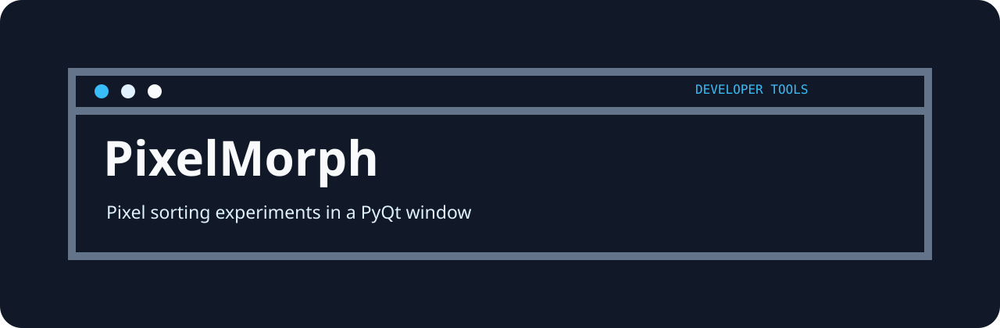

# Pixelmorph



A focused Python project from Mert Efe Kurt.

`Python`

## Start here

```bash
git clone https://github.com/mertefekurt/pixelmorph.git
cd pixelmorph
python -m pip install -r requirements.txt
python main.py
```

## Project map

```text
animations.py       project file
image_loader.py     project file
image_processor.py  project file
image_saver.py      project file
main.py             application entry
```

## Repository

[Open the source on GitHub →](https://github.com/mertefekurt/pixelmorph)
